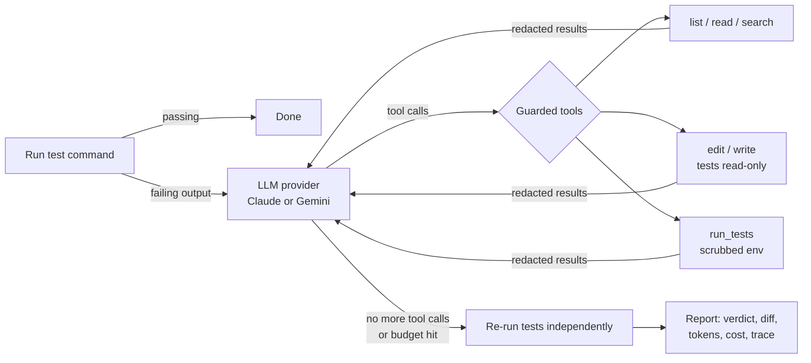

# Greenlight

**An AI agent that fixes failing tests.** Point it at a repository and it runs your test suite, reads the failures, finds the root cause, edits the code, and re-runs the tests until they pass. Then it checks the result itself instead of trusting the model.

- **Bring your own key.** It runs on your machine with your Claude or Gemini API key. Your key goes only to the provider's API.
- **Multi-provider.** One agent loop, with interchangeable Claude and Gemini backends.
- **Guardrails built in.** It never touches secret files, its tests run without your credentials, test files are read-only, and it stops at a hard step, token and cost budget.
- **Measured.** It ships with an eval suite of buggy repositories and reports pass rate, cost and steps per model.

> 📽️ *Demo GIF: record one with [vhs](https://github.com/charmbracelet/vhs) or asciinema and put it here.*

## Why

Failing builds are a constant tax on engineering teams: a dependency bump breaks a test, or a refactor misses an edge case. Greenlight handles the first pass. It reproduces the failure, finds a fix, proves the fix with the project's own tests, and hands you a reviewable diff.

## Quick start

```bash
git clone https://github.com/<you>/greenlight && cd greenlight
python -m venv .venv && source .venv/bin/activate
pip install -e .

# Give it your key (pick one):
export ANTHROPIC_API_KEY=...              # or GEMINI_API_KEY
greenlight auth set claude                # stores it in the OS keychain (input hidden)

# Try it on a bundled buggy repo (copy it so the original stays broken):
cp -r evals/tasks/cross_module_discount /tmp/demo
greenlight fix /tmp/demo --test-cmd "python -m pytest -q"
```

Useful options:

| Option | Default | |
|---|---|---|
| `--provider` | `claude` | `claude` or `gemini` |
| `--model` | `claude-opus-5-5` / `gemini-3.8-flash` | any model id the provider supports |
| `--test-cmd` | `pytest -q` | any command; exit code 0 means pass |
| `--max-steps` / `--max-cost` | `30` / `$1.00` | hard limits per run |
| `--review` | off | show each diff and ask before applying it |
| `--allow-test-edits` | off | let the agent modify test files |

The exit code is `0` when the tests pass at the end, so Greenlight can be chained in scripts and CI.

## How it works



| Module | Responsibility |
|---|---|
| [`agent.py`](src/greenlight/agent.py) | The loop: initial test run, model turns, tool dispatch, budgets, independent verification, trace |
| [`providers/`](src/greenlight/providers) | One `Provider` interface (`start` / `step` / `add_tool_results`) with Claude and Gemini adapters |
| [`tools.py`](src/greenlight/tools.py) | The six tools the model can call, bound to one workspace |
| [`security.py`](src/greenlight/security.py) | Path confinement, secret-file denylist, env scrubbing, redaction |
| [`keys.py`](src/greenlight/keys.py) | BYOK resolution: env var → OS keychain |
| [`cli.py`](src/greenlight/cli.py) | `greenlight fix` and `greenlight auth` |

**Design decisions worth calling out:**

- **A hand-written agent loop, not the SDK's automatic function calling.** Every tool call is visible, guarded, logged and counted against the budget.
- **Native message history per provider.** Claude's thinking blocks and Gemini's thought signatures have to be sent back unchanged, so each adapter keeps its own format rather than converting to a common one and losing data.
- **No general shell tool.** The model can run *your* test command (optionally narrowed to one test file), nothing else. That removes the biggest prompt-injection and exfiltration risk.
- **Edits are exact string replacements**, so the model never rewrites whole files and changes stay reviewable.
- **Prompt caching** on Claude: the history is re-sent every step, so the growing prefix is cached (the cached share is shown in the run report).
- **Refusal fallbacks** on Claude: server-side `fallbacks: "default"` retries a declined request on another model instead of failing the run.

## Security model

Greenlight runs code and reads files on your machine, and sends what it reads to an LLM. Here is what limits that:

| Threat | Mitigation |
|---|---|
| Your API key leaks | The key is read from an env var or the OS keychain, is never accepted as a CLI flag (shell history), is never written to disk, and is masked in all output |
| The agent reads secrets and sends them to the LLM | `.env*`, `*.pem`, `*.key`, `id_rsa*`, `.netrc`, `credentials*` and `.git/` are refused by every tool and hidden from listings and search |
| Test code reads credentials from the environment | The test command runs with every `*KEY*`/`*TOKEN*`/`*SECRET*`/provider-prefixed variable removed |
| Secrets appear in file contents or test output | Key-shaped strings (Anthropic, Google, GitHub, AWS, private keys) and known key values are redacted before reaching the model, the terminal or the trace |
| Path traversal / symlink escape | Paths are resolved (including symlinks) and must stay inside the repository |
| Prompt injection via repo contents | No arbitrary shell; the system prompt treats file contents as data; arguments to `run_tests` can't add flags |
| Reward hacking (weakening tests) | Test files are read-only by default, and the eval marks a task failed if any test file changed |
| Runaway spend | Hard limits on steps, tokens and estimated USD cost |

Not covered yet: the test command itself runs unsandboxed. If you don't trust the repository's code, run Greenlight inside a container (see the roadmap).

## Evaluation

[`evals/tasks/`](evals/tasks) contains small repositories, each with one realistic planted bug:

| Task | Bug |
|---|---|
| `pagination` | Off-by-one page offset and floor instead of ceil for the page count |
| `mutable_default` | Shared mutable default argument |
| `csv_quoted_fields` | Naive `split(",")` ignores quoted fields and escaped quotes |
| `cross_module_discount` | The test fails in `cart.py`; the bug is in `pricing.py` (percent vs. fraction) |
| `retry_backoff` | Exponent off by one and the cap is ignored |

```bash
python evals/run_eval.py --provider claude
python evals/run_eval.py --provider gemini
```

Each task runs in a temporary copy. It counts as solved only if the test command passes **and** no test file was modified. Results go to `evals/results/`.

| Model | Solved | Avg. steps | Total cost |
|---|---|---|---|
| `claude-opus-5-5` | _run the eval_ | | |
| `gemini-3.8-flash` | _run the eval_ | | |

## Development

```bash
pip install -e ".[dev]"
pytest -q            # 57 tests, no API key or network needed (scripted fake provider)
ruff check . && ruff format --check .
```

CI runs lint and tests on Python 3.10 to 3.13, plus a [gitleaks](https://github.com/gitleaks/gitleaks) secret scan.

## Roadmap

- [ ] Docker sandbox for the test command
- [ ] GitHub Action: run on a failing CI job and open a PR with the fix
- [ ] More eval tasks (multi-file refactors, dependency upgrades, JS/TS projects)
- [ ] OpenTelemetry tracing

## License

MIT
