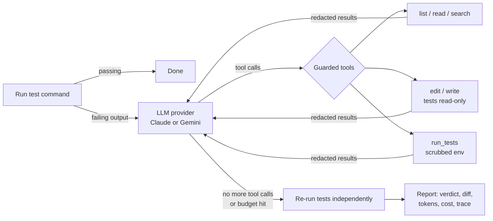

# Greenlight

[](https://coding-agent-b.streamlit.app/)
[](https://github.com/parthacs1999/coding-agent/actions/workflows/ci.yml)
[](LICENSE)

**An AI agent that fixes failing tests.** Point it at a repository and it runs your test suite, reads the failures, finds the root cause, edits the code, and re-runs the tests until they pass. Then it checks the result itself instead of trusting the model.

- **Bring your own key.** It runs on your machine with your Claude or Gemini API key. Your key goes only to the provider's API.
- **Multi-provider.** One agent loop, with interchangeable Claude and Gemini backends.
- **Guardrails built in.** It never touches secret files, its tests run without your credentials, test files are read-only, and it stops at a hard step, token and cost budget.
- **Measured honestly.** Two benchmarks: a [synthetic suite](#evaluation) with hidden tests (10/10), and a [real-world benchmark](#real-world-benchmark-22-real-bugs-from-open-source-projects) of **22 real bug fixes** from open-source libraries, built the SWE-bench way and verified with an oracle (a small model solves 31%). Every fix's diff is published.
- **Works where teams work.** A CLI, a [web UI](https://coding-agent-b.streamlit.app/), and a [GitHub Action](#github-action-fix-failing-ci-automatically) that turns a failing CI run into a pull request for review.

**▶ [Try it live in your browser](https://coding-agent-b.streamlit.app/)**: pick a broken demo project and press **"Watch a recorded run"** to see the agent fix it, **no API key needed**. Or paste your own Gemini or Claude key and run it live. Your key is used for that one run and never stored.


*A real, unedited run of the web UI with `gemini-3.5-flash-lite` (shown at 1.4× speed). The failing test is in `cart.py`, but the bug is in `pricing.py`. The agent follows the import, fixes the formula, and Greenlight re-runs the tests itself: **fixed and verified, 1 failed → 4 passed, in 8 steps**. The key is typed into a password field, so it only ever shows as dots. [Watch the full-quality video (MP4)](docs/ui-demo.mp4) · recorded with Playwright by [`docs/record_ui_demo.py`](docs/record_ui_demo.py).*

## Why

Failing builds are a constant tax on engineering teams: a dependency bump breaks a test, or a refactor misses an edge case. Greenlight handles the first pass. It reproduces the failure, finds a fix, proves the fix with the project's own tests, and hands you a reviewable diff.

## Quick start

```bash
git clone https://github.com/<you>/greenlight && cd greenlight
python -m venv .venv && source .venv/bin/activate
pip install -e .

# Give it your key (pick one):
export ANTHROPIC_API_KEY=...              # or GEMINI_API_KEY
greenlight auth set claude                # stores it in the OS keychain (input hidden)

# Try it on a bundled buggy repo (copy it so the original stays broken):
cp -r evals/tasks/cross_module_discount /tmp/demo
greenlight fix /tmp/demo --test-cmd "python -m pytest -q"
```


*The CLI on the same bug (`gemini-3.1-flash-lite`, real run, FIXED in 8 steps). Recorded with [vhs](https://github.com/charmbracelet/vhs) from [`docs/demo.tape`](docs/demo.tape).*

### Web UI

**Hosted demo:** https://coding-agent-b.streamlit.app/ (on Streamlit Community Cloud's free tier, it may take ~30s to wake up).

To run it yourself:

```bash
pip install -e ".[ui]"
greenlight ui            # opens http://127.0.0.1:8501
```

Pick a buggy demo repo (or, locally, any folder), choose Claude or Gemini, and watch the agent's tool calls stream live. You get the diff, the agent's summary, and a cost report at the end.

**No API key? Watch a recorded run.** Every demo project has a **replay of a real run**, recorded with a real model and played back through the same live view (stage tracker, activity feed, diff, verdict) in about 10 seconds. It's clearly labelled as a replay: no AI calls are made and no key is needed, so anyone (a recruiter, say) can see the agent work without signing up for anything. Replays are recorded by [`scripts/record_replays.py`](scripts/record_replays.py), which only saves runs that end fixed. A test applies every replay's diff to a fresh copy of its project and checks it passes the **hidden** tests, so the replays show genuine fixes, not lucky ones.

**Running out of free quota?** Gemini's free tier gives each API key a small daily quota *per model*. That's set by Google, so no app can raise it, and because visitors bring their own key, each visitor has their own. To make the most of it, the web UI defaults to a lite model (`gemini-3.5-flash-lite`), which allows far more free requests than `gemini-3.8-flash` (20 a day, about 2 fixes). If a run hits the quota, the UI says so in one sentence and offers **one-click buttons to switch to another model**, since each model's quota is separate. For unlimited use, enable billing on your Google AI key (a lite-model fix costs a fraction of a cent) or use a Claude key.

The same app deploys to [Streamlit Community Cloud](https://streamlit.io/cloud) for free: point it at this repo with `streamlit_app.py` as the entry file.

Everyone brings their own key, in every mode. The UI never reads keys from the server's environment or keychain. A pasted key is used for one run, is never written anywhere, is cleared from the session when the run starts, and is dropped from memory when the run ends. Hosted mode is the default and is locked down further: only the bundled demo projects can be run, each on a temporary copy, with a fixed test command. Your own folders are only available through `greenlight ui` on your machine.

### CLI options

| Option | Default | |
|---|---|---|
| `--provider` | `claude` | `claude` or `gemini` |
| `--model` | `claude-opus-5-5` / `gemini-3.8-flash` | any model id the provider supports (see the note below) |
| `--test-cmd` | `pytest -q` | any command; exit code 0 means pass |
| `--max-steps` / `--max-cost` | `30` / `$1.00` | hard limits per run |
| `--review` | off | show each diff and ask before applying it |
| `--allow-test-edits` | off | let the agent modify test files |

The exit code is `0` when the tests pass at the end, so Greenlight can be chained in scripts and CI.

**Gemini free tier:** each model has its own small daily request quota (as low as 20 requests per day), and a fix takes about 5–10 requests. If you hit `429 RESOURCE_EXHAUSTED`, Greenlight tells you which model ran out and when it resets. Switch models with `--model` (lite models like `gemini-3.5-flash-lite` allow the most free requests), wait for the reset, or enable billing on your key. Temporary `503` overload errors are retried automatically.

### GitHub Action: fix failing CI automatically

When your CI fails, Greenlight can try a fix and open a pull request for a human to review:

```yaml
- uses: parthacs1999/coding-agent@main
  id: greenlight
  with:
    api-key: ${{ secrets.GEMINI_API_KEY }}   # your own key, from a repository secret
    provider: gemini                         # or claude
    test-command: python -m pytest -q

- uses: peter-evans/create-pull-request@v7
  if: steps.greenlight.outputs.fixed == 'true'
  with:
    body-path: ${{ steps.greenlight.outputs.body-path }}   # explanation + diff
```

A complete, copy-paste workflow is in [`examples/greenlight-on-ci-failure.yml`](examples/greenlight-on-ci-failure.yml). It runs when your CI workflow fails and opens a PR on a `greenlight/…` branch. The run summary shows the agent's explanation, the diff, tokens and time. Outputs: `status`, `fixed`, `steps`, `body-path`.

Built for safety in CI:
- **Fork code never gets your key.** The example only runs for branches in your own repository. `workflow_run` jobs can read secrets, and running them on fork code is a classic way to leak them.
- **No script injection.** Action inputs are passed through environment variables, never pasted into shell scripts.
- **Your key is masked by GitHub** and stripped from the test process's environment by Greenlight.
- **It suggests, it doesn't merge.** A pull request is opened for human review, and passing tests are necessary but not sufficient.

To try it on this repo: add a `GEMINI_API_KEY` secret, then run **Actions → Greenlight demo → Run workflow** and pick a buggy project ([workflow](.github/workflows/greenlight-demo.yml)).

## How it works



| Module | Responsibility |
|---|---|
| [`agent.py`](src/greenlight/agent.py) | The loop: initial test run, model turns, tool dispatch, budgets, independent verification, trace |
| [`providers/`](src/greenlight/providers) | One `Provider` interface (`start` / `step` / `add_tool_results`) with Claude and Gemini adapters |
| [`tools.py`](src/greenlight/tools.py) | The six tools the model can call, bound to one workspace |
| [`security.py`](src/greenlight/security.py) | Path confinement, secret-file denylist, env scrubbing, redaction |
| [`keys.py`](src/greenlight/keys.py) | BYOK resolution: env var → OS keychain |
| [`cli.py`](src/greenlight/cli.py) | `greenlight fix`, `greenlight ui` and `greenlight auth` |
| [`action.yml`](action.yml), [`github_report.py`](src/greenlight/github_report.py) | GitHub Action: run on CI failure, write a job summary and a PR body |
| [`streamlit_app.py`](src/greenlight/streamlit_app.py) | Web UI: live run log, diff and report; local vs. hosted mode |

**Design decisions worth calling out:**

- **A hand-written agent loop, not the SDK's automatic function calling.** Every tool call is visible, guarded, logged and counted against the budget.
- **Native message history per provider.** Claude's thinking blocks and Gemini's thought signatures have to be sent back unchanged, so each adapter keeps its own format rather than converting to a common one and losing data.
- **No general shell tool.** The model can run *your* test command (optionally narrowed to one test file), nothing else. That removes the biggest prompt-injection and exfiltration risk.
- **Edits are exact string replacements**, so the model never rewrites whole files and changes stay reviewable.
- **Prompt caching** on Claude: the history is re-sent every step, so the growing prefix is cached (the cached share is shown in the run report).
- **Refusal fallbacks** on Claude: server-side `fallbacks: "default"` retries a declined request on another model instead of failing the run.

## Security model

Greenlight runs code and reads files on your machine, and sends what it reads to an LLM. Here is what limits that:

| Threat | Mitigation |
|---|---|
| Your API key leaks | The key is read from an env var or the OS keychain, is never accepted as a CLI flag (shell history), is never written to disk, and is masked in all output |
| The agent reads secrets and sends them to the LLM | `.env*`, `*.pem`, `*.key`, `id_rsa*`, `.netrc`, `credentials*` and `.git/` are refused by every tool and hidden from listings and search |
| Test code reads credentials from the environment | The test command runs with every `*KEY*`/`*TOKEN*`/`*SECRET*`/provider-prefixed variable removed |
| Secrets appear in file contents or test output | Key-shaped strings (Anthropic, Google, GitHub, AWS, private keys) and known key values are redacted before reaching the model, the terminal or the trace |
| Path traversal / symlink escape | Paths are resolved (including symlinks) and must stay inside the repository |
| Prompt injection via repo contents | No arbitrary shell; the system prompt treats file contents as data; arguments to `run_tests` can't add flags |
| Reward hacking (weakening tests) | Test files are read-only by default, and the eval marks a task failed if any test file changed |
| Runaway spend | Hard limits on steps, tokens and estimated USD cost |
| Web UI: a key left in the browser or server | Pasted keys are moved out of the input field the moment you press Run, used for that run, then dropped from memory (`forget_secret`). The UI never reads server-side keys |
| Web UI: a malicious website driving your local UI (DNS rebinding) | `greenlight ui` binds to 127.0.0.1 and only accepts WebSocket connections whose Host is `localhost`/`127.0.0.1` |
| Web UI: HTML/Markdown injection from repo content | Repo- and model-derived text is HTML-escaped and rendered with `st.html` (scripts stripped, no Markdown) or as plain text/code. Tracebacks are hidden from visitors |
| Hosted demo: one visitor exhausting the server | At most 2 concurrent runs, 20 steps, 60s per test run, and CPU-time and file-size limits on the test process |

Not covered yet: the test command runs without a full sandbox (the limits above are not isolation). If you don't trust a repository's code, run Greenlight inside a container (see the roadmap).

## Evaluation

[`evals/tasks/`](evals/tasks) contains 10 small repositories with realistic planted bugs, from easy to hard:

| Task | Difficulty | What makes it tricky |
|---|---|---|
| `pagination` | easy | Off-by-one page offset; floor instead of ceil for the page count |
| `mutable_default` | easy | Shared mutable default argument |
| `retry_backoff` | easy | Exponent off by one; the cap is ignored |
| `cross_module_discount` | medium | The test fails in `cart.py`, but the bug is in `pricing.py` |
| `csv_quoted_fields` | medium | Naive `split(",")` ignores quoted fields and escaped quotes |
| `lru_cache` | hard | Two recency bugs; hidden tests check the exact eviction order |
| `interval_merge` | hard | Missing sort, an off-by-one boundary, and the input must not be mutated |
| `inventory_service` | hard | 3 files: a lost update across layers, plus a batch operation that isn't all-or-nothing |
| `split_bill` | hard | Cents must add up exactly; property-based hidden tests |
| `config_parser` | hard | Five separate bugs in one function |

```bash
python evals/run_eval.py --provider claude
python evals/run_eval.py --provider gemini --tasks lru_cache split_bill
```

**How tasks are scored (built to resist gaming):**

- Each task runs in a temporary copy, and the agent only sees the task's own tests.
- A task counts as solved only if **(1)** the visible tests pass when Greenlight re-runs them, **(2)** no test file was modified, and **(3)** the task's **hidden tests** in [`evals/hidden/`](evals/hidden) also pass. Hidden tests are copied in only after the agent has finished, as in SWE-bench. They test the documented behaviour on new inputs, so hard-coding the visible test values or patching only the visible symptom fails.
- The harness itself is tested: [`tests/test_eval.py`](tests/test_eval.py) checks that a real fix scores as solved and that a fix hard-coding the visible test values is caught. Each task was also validated against reference and "cheating" fixes before being added.
- **Every fix's diff is saved** in [`evals/results/<model>/`](evals/results), so you can read exactly what the agent changed.

**Results** (2026-10-14):

| Model | Solved | Easy | Medium | Hard | Avg. steps | Tokens | Wall time | Cost |
|---|---|---|---|---|---|---|---|---|
| `gemini-3.1-flash-lite` | **10 / 10** | 3/3 | 2/2 | 5/5 | 7.1 | 138k | 264s | free tier |
| `claude-opus-5-5` | not run yet | | | | | | | |

Every task passed its hidden tests as well as its visible ones, and no fix was caught gaming the visible tests. The diffs are genuine root-cause fixes. For example, the agent made `reserve_many` a proper two-phase check-then-apply operation and fixed all five `config_parser` bugs ([read the diffs](evals/results/gemini-gemini-3.1-flash-lite)).

**What this does and doesn't show:** the agent loop, tools and verification work reliably across different kinds of bugs, even with a small, cheap model. A small model scoring 10/10 also means these tasks are too easy to separate strong models from each other. That's why there's a second, much harder benchmark built from real bugs.

## Real-world benchmark: 22 real bugs from open-source projects

Synthetic tasks show the loop works. Real bugs show how well it works. [`evals/realworld/`](evals/realworld) reproduces **22 real bug-fix commits** from 8 well-tested open-source Python libraries (`more-itertools`, `cachetools`, `tabulate`, `sqlparse`, `semver`, `boltons`, `parse`, `toolz`), using SWE-bench's method:

1. **Mine** ([`mine.py`](evals/realworld/mine.py)): scan each project's git history for commits whose message describes a bug fix, which change both source and tests, and whose source change is small (≤ 40 lines).
2. **Reproduce the bug:** take the project at the fix commit and revert *only the source part* of the fix. The bug comes back, and the tests the maintainers added with the fix now fail.
3. **Validate automatically.** A commit becomes a task only if the maintainers' new tests fail on the restored bug (**FAIL_TO_PASS**), they pass with the real fix, the test files still import (it's a bug, not a missing feature), the code is imported from the workspace, and the rest of the suite passes at the fix (**PASS_TO_PASS**). 30 candidate commits were rejected.
4. **Score:** solved = FAIL_TO_PASS pass **and** no PASS_TO_PASS test regresses (the whole project suite is re-run, 82–768 tests per task) **and** no test file was edited.

**The scorer is verified with an oracle** ([`run.py --oracle`](evals/realworld/run.py)): for all **22/22** tasks, the maintainers' real fix scores as *solved* and the untouched bug scores as *not solved*. The harness is also unit-tested offline ([`tests/test_realworld.py`](tests/test_realworld.py)).

**Contamination:** 19 of the 22 fixes were committed in 2026, 10 of them within six weeks of the run. That makes it less likely, though not impossible, that a model saw these exact fixes during training.

**Results** (2026-10-14, `gemini-3.1-flash-lite`, 30-step limit):

| Outcome | Tasks |
|---|---|
| ✅ Solved (real fix, no regressions in the project's suite) | 4 |
| ❌ Fixed the target test but broke another (regression) | 1 |
| ⏸️ Out of steps | 8 |
| **Pass rate** | **4 / 13 attempted (31%)** |
| ⚠️ Not attempted: the free-tier quota ran out mid-run (`429`/`503`) | 9 |

Tasks stopped by quota or overload aren't counted as failures. They aren't a verdict on the model, and `--resume` re-runs only those. Full per-task results: [`COMPARISON.md`](evals/results/realworld/COMPARISON.md) and the [saved diffs](evals/results/realworld/gemini-gemini-3.1-flash-lite).

**What the results show:**
- **Real bugs are much harder than synthetic ones:** 31% here against 100% on the synthetic suite. Most failures ran out of steps exploring large real files (`more-itertools`' main module is about 5,000 lines).
- **Passing tests isn't the same as good code.** In `cachetools-bcf9e81` the agent's fix is correct (it adds the same empty-cache check as the maintainers') but leaves a redundant `try/raise` and a no-op `except Exception: raise`. That's why the GitHub Action opens a pull request for human review instead of merging.
- **Model comparison is next.** The harness supports any Gemini or Claude model (`run.py --provider claude --model …`), and [`compare.py`](evals/realworld/compare.py) builds a leaderboard with cost per solved bug. Comparing models fairly needs more quota than the free tier gives.

```bash
python evals/realworld/mine.py                        # find and validate tasks (clones into ~/.cache)
python evals/realworld/run.py --oracle                # check the scorer with the real fixes
python evals/realworld/run.py --provider gemini --model gemini-3.1-flash-lite
python evals/realworld/run.py --provider gemini --model gemini-3.1-flash-lite --resume
python evals/realworld/compare.py                     # leaderboard + task-by-model grid
```

## Development

```bash
pip install -e ".[dev]"
pytest -q            # 119 tests, incl. headless UI and benchmark-harness tests; no API key or network needed
ruff check . && ruff format --check .
```

CI runs lint and tests on Python 3.10 to 3.13, plus a [gitleaks](https://github.com/gitleaks/gitleaks) secret scan.

## Roadmap

- [ ] Docker sandbox for the test command
- [x] GitHub Action: run on a failing CI job and open a PR with the fix
- [x] Harder eval tasks with hidden tests and saved diffs
- [x] Real-world benchmark: 22 real bug fixes from open-source repos (SWE-bench style)
- [ ] Model comparison on the real-world benchmark (Claude vs Gemini, cost per solved bug)
- [ ] JS/TS projects
- [ ] OpenTelemetry tracing

## License

MIT
